--- 
layout: post
title: "Fuente del Norte: From Belize City to Flores by Direct Bus"
date: "November 10, 2026"
description: "The once-daily Fuente del Norte bus between Belize City and Flores is a rare trifecta of travel: it is the cheapest, quickest, and most comfortable option for getting between two popular hubs for Central American tourism."
image: floresfeatured.jpg
---

At five hours and $20 USD, travelling direct between Belize City and Flores is economical and efficient.  This was one of the easiest, most convenient long-distance busses I have taken in Central America.

## Introduction

Belize City is the primary gateway for Belize's beautiful cayes, as well as home to the country's only airport with commercial international service.  While the city itself has little to offer for an extended stay, most visitors will find themselves passing through to get in and out of Belize—making it very well connected.  This includes three different options for getting to Flores, a popular backpacker hub with Flores Island crammed full of hostels…but also worth visiting for non-backpackers thanks to the nearby Tikal National Park.  Travellers making this journey overland can choose between local busses, tourist shuttles, or the direct Fuente del Norte service to get between Belize City and Flores; here's why I chose the latter:

## Buying Tickets

The cheapest and easiest way is to <a href="https://transportesfuentedelnorte.com/en/" target="_blank" rel="noopener noreferrer">buy online direct from Fuente del Norte</a>.  The site is a bit finicky: you have to delete some auto-populated text that comes up in the optional tax invoice fields, but otherwise it's straightforward.  International cards are accepted with no fee, though note that it is about $2 cheaper to pay in Guatemalan quetzals over US dollars (if you have a no-forex card): I paid 157.50 GTQ (equivalent to about $20.50 USD on the same day), but would have been charged $22.50 had I paid in US dollars.

<blockquote>Buying direct in local currency will get you the best price.</blockquote>

You get an email with your PDF ticket, which is all you need to board; no need to print it off.  You can also buy through third-parties at the ferry terminal, though you will pay more.

For reference, I was quoted $30 BZD (fixed 2:1, so $15 USD) for the local bus that only goes as far as the border, or $40 BZD ($20 USD) for an express bus—again just as far as the border.  So for the same price, you get a reasonably-express service all the way to Flores.  There are no nonstop flights, with the most direct option being via Guatemala City taking three hours (not including time spent getting to/from airports) and costing around $400 USD.  This is not a reasonable option unless you have an irrational fear of overland travel…in which case you're probably not reading this article to begin with.

## Leaving Belize City

The address on your ticket will be **111 North Front Street**, which is actually the address for the San Pedro Express ferry terminal.  The bus leaves from a parking lot next door, about a 30-second walk.  You can wait at the terminal, or there is some shade in the parking lot itself.

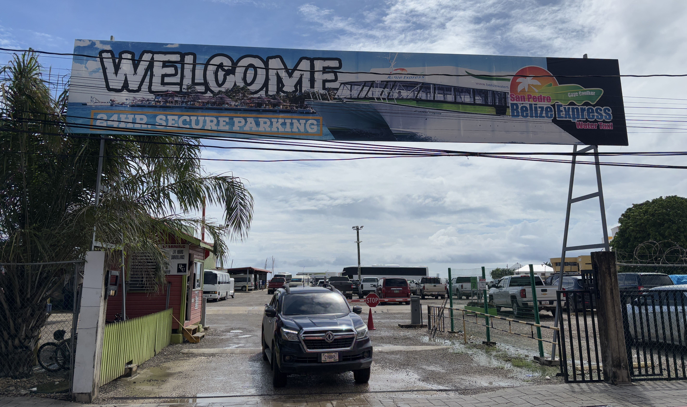

It's a very welcoming parking lot.

I arrived at 11:50 for the 12:00 departure, and our bus from Flores arrived at almost the exact same time.  It is an unmarked white bus with Belizean plates, but the Spanish-speaking driver and assistant give a good hint as to its destination.  Large bags go under the bus: very informal, they weren't weighed and you don't get a baggage ticket.  Each passenger is theoretically limited to 35 pounds of baggage, though that wasn't enforced…still, if you show up carrying all your worldly possessions, you may be charged 3 GTQ per pound above this limit.

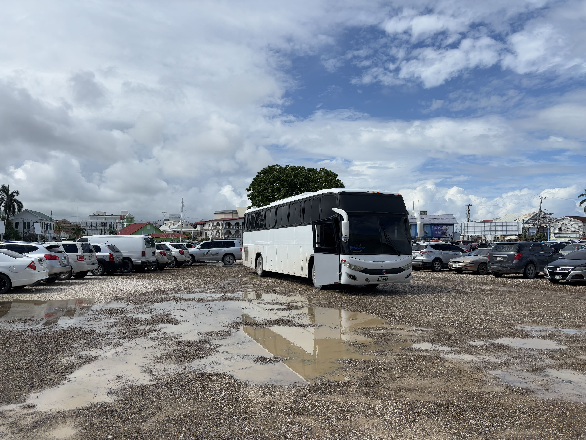

No signage, but the bus is hard to miss.

You're welcome to bring food and drinks on board.  The vendors at the ferry terminal are all over-priced but there is a convenience store directly across the street selling snacks and cold drinks.  We didn't leave until 12:29: Fuente del Norte appears to sell most of its tickets via third-party tour operators, and we waited for a few tourist vans bringing people to the ferry terminal. 

## On Board

Seats are assigned but this doesn't matter, sit wherever.  The faux leather seats were a horrible choice: even with strong air conditioning, they get…clingy.  Individual air vents that work and reading lights that don't are located above each seat pair.  Recline is decent and each seat has a footrest.

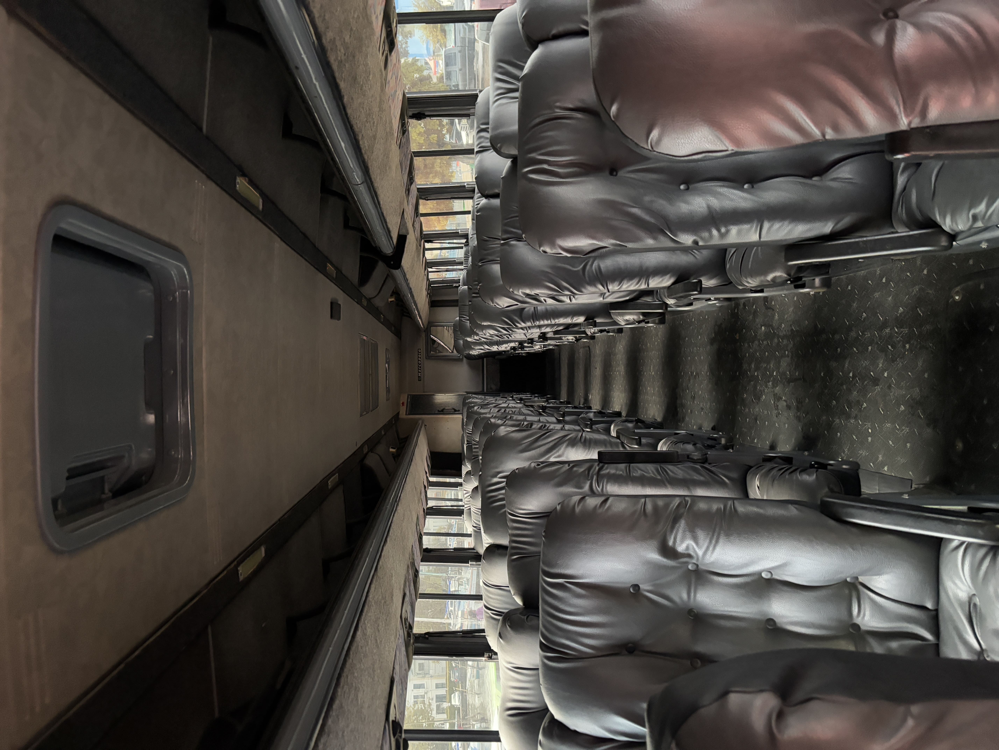

Not exactly the last word in luxury, but very good for Central America.

Unusually for Central American busses, you don't get curtains to block out the sun.  Instead windows are heavily tinted.  This works somewhat, though definitely try and sit on the side facing away from the sun.  Also try and sit away from the air conditioning unit located roughly halfway down the bus: this leaks, a lot.  The A/C stopped working/was turned off intermittently for the final hour of the journey, which is when I discovered that windows also open.

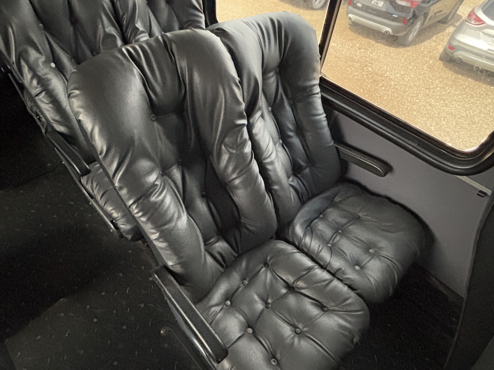

Decent recline, but the window tint isn't a great solution for blocking the sun.

As expected there were no other amenities: no power outlets, no WiFi.  Cell service is reliable along the whole route though.

There is a washroom at the rear of the bus.  It serves its purpose, but is not air conditioned so the smell…permeates.  I wouldn't want to sit in the last five rows.

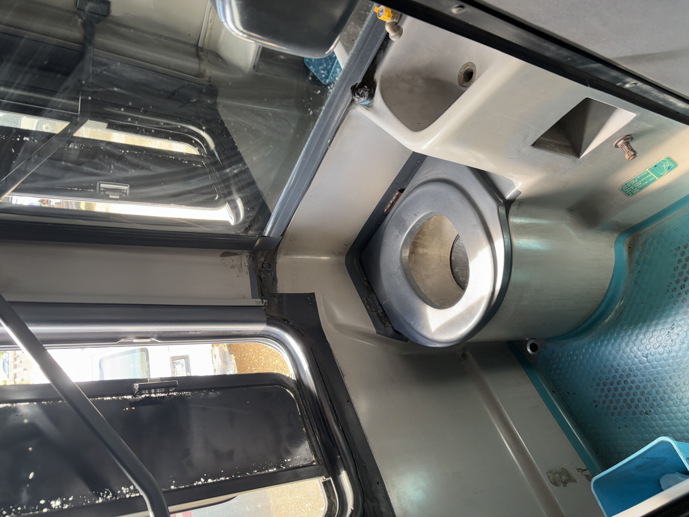

It serves its purpose.

Other than 20 minutes spent puttering about San Ignacio picking up and dropping off cargo and passengers, the bus was direct: no extended stops, no detours to pick up the driver's buddy, no picking up a local every 100 metres along the road.  We reached the border just after 3 p.m.

## Border Crossing

Take your hand bags with you, but large bags stay under the bus.  Passengers walk across the border, which is a three-step process: pay your $40 BZD/$20 USD Belizean exit fee (cash or card), get stamped out of Belize, then walk about 50 metres and get stamped into Guatemala.  This was the easiest land border crossing I have ever had in the Americas: there were no lines, no unnecessary questions, and both sides had clean facilities.  Indeed it was so seamless I inadvertently waked right into Guatemala and had to turn back.  It reminded me of <a href="https://ratherbeexploring.github.io/blog/crossing-by-foot-from-foz-do-iguacu-to-ciudad-del-este/" target="_blank" rel="noopener noreferrer">crossing from Brazil into Paraguay</a>, where most people don't need a passport stamp so you have to go out of your way to get one.  Make sure you are both stamped out of Belize and into Guatemala though, as failing to do so will likely lead to fines when you cross the next border.

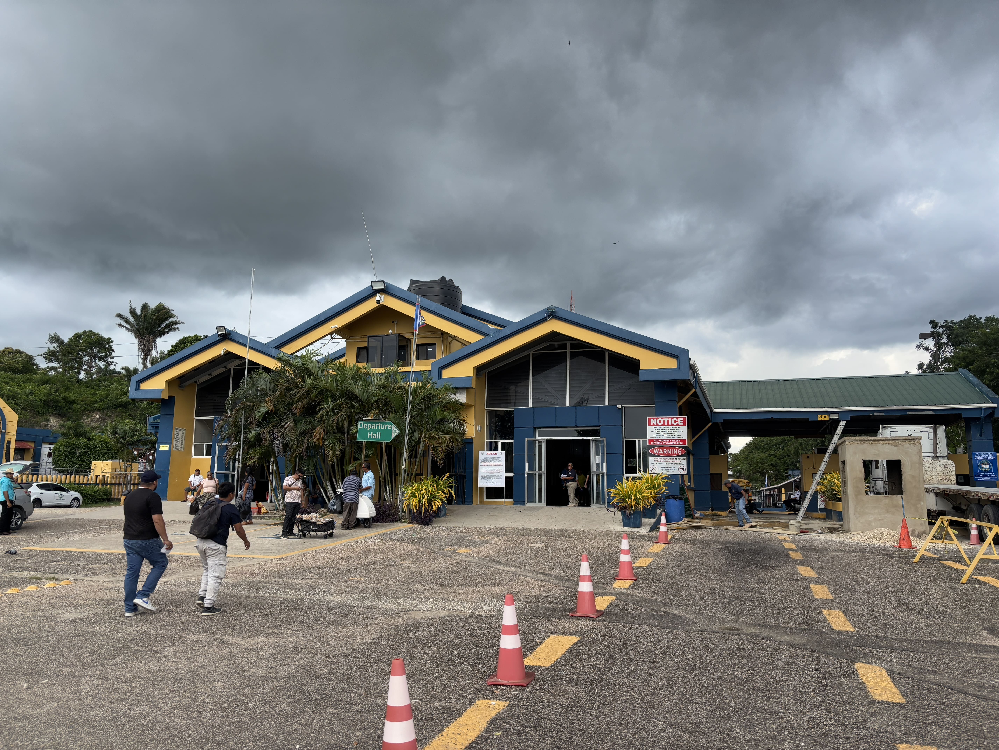

Quick and efficient.  Washrooms are located to the left on the main entrance.

You are protected from the elements for the full process, either by covered walkways or inside air-conditioned buildings.  The Belizean side has washrooms.

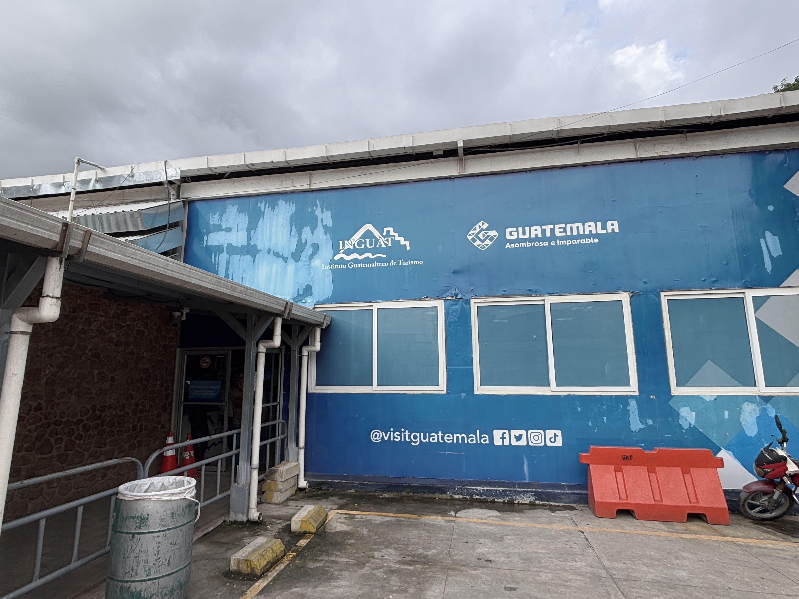

You can just walk right through this building, but make sure to get stamped into or out of Guatemala first.

Currency exchangers will swarm the bus as soon as it stops.  Walk past these ones and swap your money on the Guatemalan side: after entering the country there will be around a dozen men either wearing chest-strap bags or just holding huge wads of cash.  They aren't pushy and give good rates: 7.5:1 for US dollars, which was identical to the rate offered by banks in both Flores and Guatemala City.  Exchanging at the border is quicker and safer: Guatemalan banks want a scan of your passport and detailed personal information, which I'm sure is stored on a system with cutting-edge security.  Informal currency exchangers just want your cash.  ATMs in Guatemala charge high fees (around $8 USD) and are often empty.

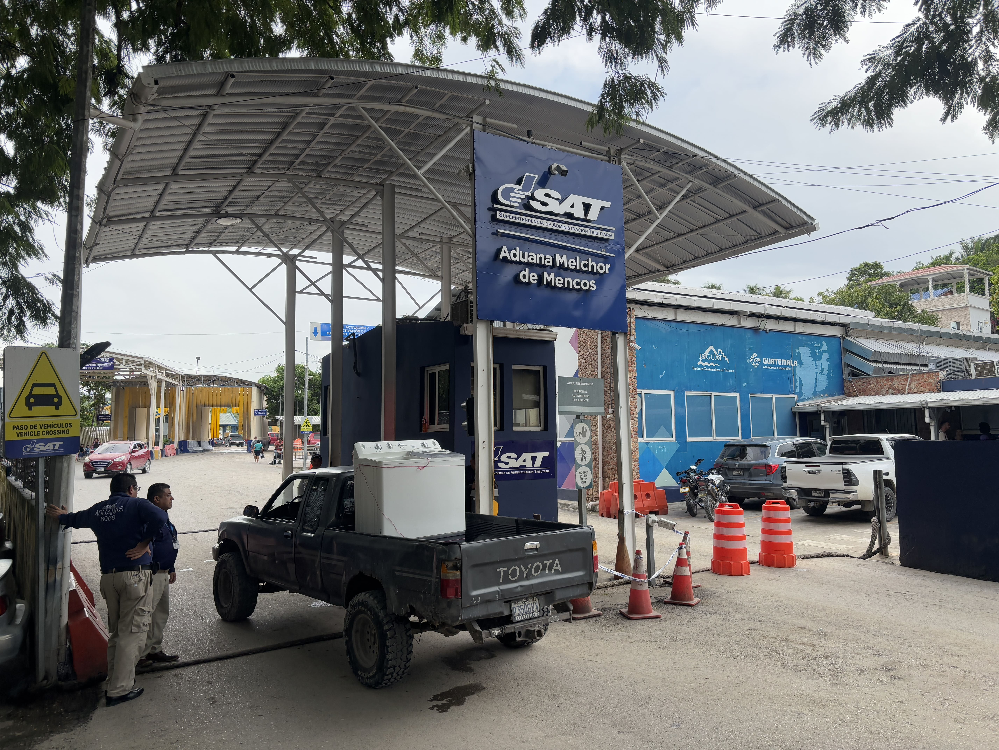

Once you're in Guatemala, currency conversion is quick and the rates are good.

There were a small number of vendors on the Belizean side.  On the Guatemalan side you'll find several restaurants and shops, with prices comparable to what you'd pay in Flores (maybe 5-10% more for water, etc).  The border is safe on both sides, with a visible police and military presence.  I got myself a Gallo beer (the aforementioned police/military don't care) and waited for the bus.

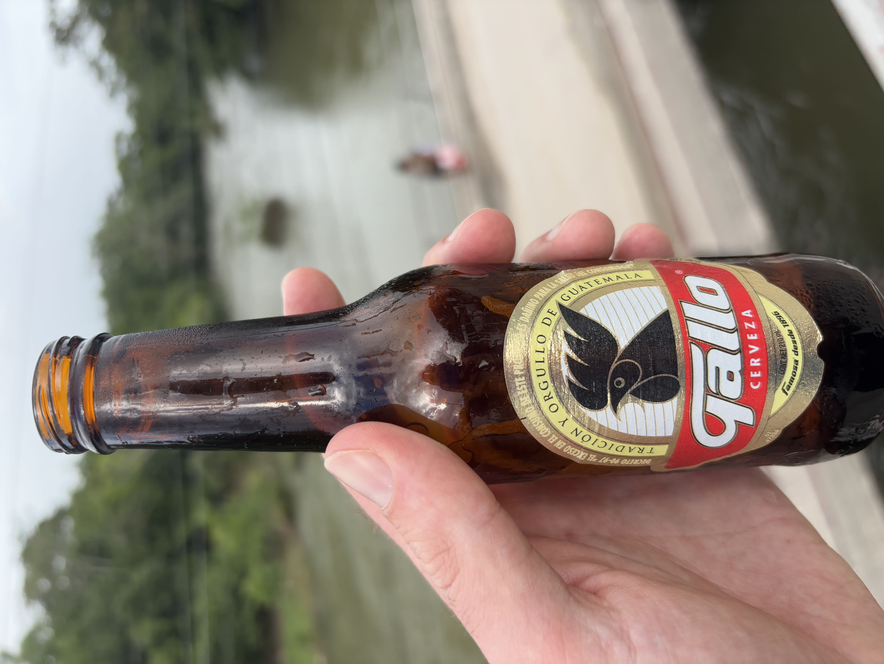

The border crossing wasn't difficult, but I still earned a beer.

Our coach crossed separately, then drove about 100 metres past the border, over the bridge.  This was the only time passengers were exposed to the elements, though it was a lovely day so I didn't mind.  The driver took a headcount, and we were on the road again at 3:49 p.m.

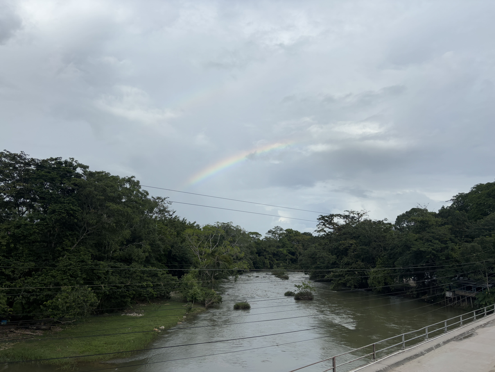

Dare I call this border crossing pleasant?

## Arriving in Flores

The bus terminates at Santa Elena station.  As mentioned Flores is a hub for backpackers, and Fuente del Norte does offer a shuttle to Isla de Flores where most hostels are located.  I opted to stay near the terminal instead: the area is safe and you'll find much cheaper, better food off the island than on it.  The terminal itself has food options, a 5B ATM (which accepts foreign cards, but charges 57.50 GTQ), and paid washrooms.

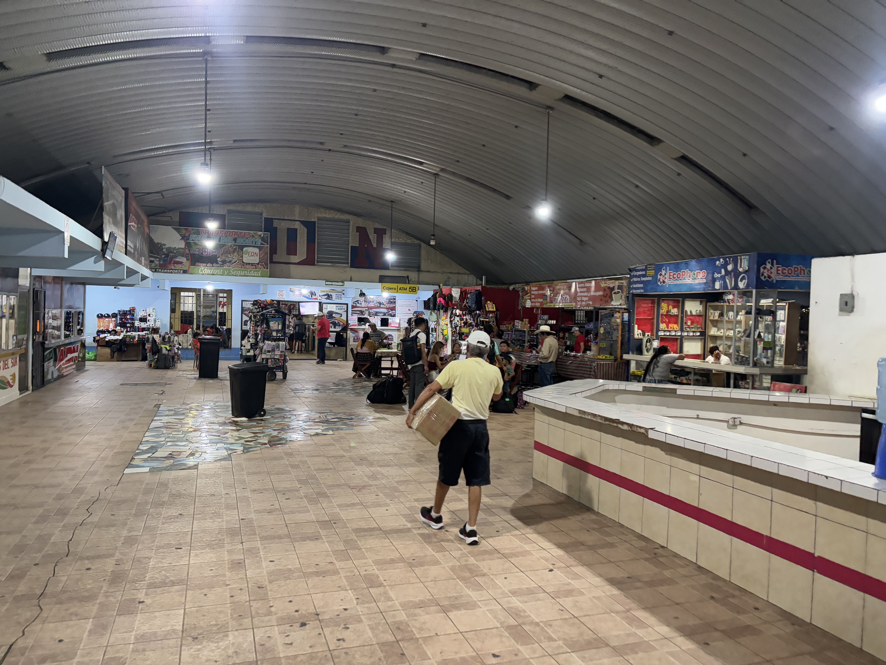

Not much but it beats a parking lot.

We arrived at 5:33 p.m., almost five hours exactly after leaving Belize City (and 5.5 hours after we were scheduled to leave).

## Final Thoughts

The Fuente del Norte bus just makes sense if you need to get between Belize City and Flores.  It is cheaper than local busses when you book direct and considerably faster, and much, much cheaper than flying (quicker too, once you factor in the time you spend getting to and waiting at airports).  Many tourist shuttles are actually just tickets for this bus with an added fee, and dedicated shuttles cost around $10 USD more and are cramped minivans.  I would absolutely travel with Fuente del Norte on this route again.
